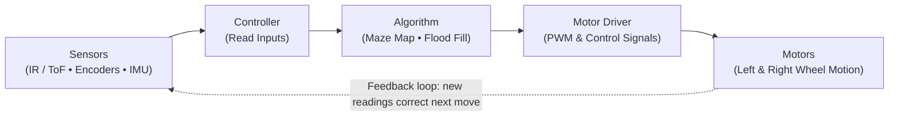

# Micromouse Robot

> **An autonomous maze-solving robot** — *Sense • Map • Plan • Move*  
> *Mechanical Engineering • Makerspace Project*

Micromouse is a compact, self-contained autonomous robot designed to navigate an unknown maze without human control. Using onboard sensors, it detects maze walls, builds an internal map, calculates a path to the target cell using a maze-solving algorithm (such as **Flood Fill**), and drives smoothly through turns and straightaways. Once the maze is mapped, the robot can execute faster speed runs along the learned route.

---

## Table of Contents

- [Project Objectives](#project-objectives)
- [System Architecture](#system-architecture)
- [How It Works](#how-it-works)
- [Hardware Overview](#hardware-overview)
- [Maze-Solving Algorithm](#maze-solving-algorithm)
- [Assembly & Testing](#assembly--testing)
- [Repository Structure](#repository-structure)
- [Learning Outcomes & Applications](#learning-outcomes--applications)
- [References & Credits](#references--credits)

---

## Project Objectives

- **Autonomous Movement:** Navigate through a maze without remote control.
- **Wall Detection:** Identify walls and open passages accurately using onboard sensors.
- **Path Planning:** Select an optimal route using a maze-solving algorithm.
- **Motor Control:** Regulate wheel speed and 90° turns with repeatable precision.
- **System Integration:** Combine mechanical chassis, electronics, sensing, and firmware.
- **Testing & Calibration:** Measure motion accuracy and improve run-to-run reliability.

---

## System Architecture

Information flows continuously from sensors to the decision-making algorithm and down to the motors in a closed feedback loop:



---

## How It Works

The robot operates on a continuous **Sense → Map → Plan → Move** cycle:

1. **Sense:** Read wall sensors (front and side), wheel encoders, and optional IMU orientation.
2. **Map:** Record newly detected walls and open passages in the maze representation.
3. **Plan:** Choose the best neighbouring cell toward the target goal.
4. **Move:** Drive forward one cell or execute a controlled turn.
5. **Repeat:** Continue updating the map and moving until the goal cell is reached.

Once the maze is explored and mapped, the robot can attempt a faster run along the known route.

---

## Hardware Overview

Typical components used in a Micromouse build *(update the table in [docs/hardware.md](docs/hardware.md) with your exact part numbers and pinout)*:

| Subsystem | Typical Components | Purpose |
| :--- | :--- | :--- |
| **Controller** | Arduino, ESP32, or STM32 | Reads sensors, runs maze mapping & Flood Fill, outputs PWM |
| **Drive System** | 2× DC geared motors, wheels, motor driver | Differential drive for forward motion and turns |
| **Wall Sensors** | IR or Time-of-Flight (ToF) sensors | Detect front, left, and right walls and estimate distance |
| **Motion Sensors** | Wheel encoders, optional Gyroscope / IMU | Measure travel distance and maintain heading |
| **Power** | Battery pack, voltage regulator, switch, wiring | Supplies regulated power to logic and motors |
| **Chassis** | Lightweight body and sensor mounts | Compact frame sized for maze cells |
| **Optional Modules** | LEDs, buzzer, display | Debugging, status indicators, and mode selection |

See [docs/hardware.md](docs/hardware.md) for detailed sensor roles and a wiring/pinout template.

---

## Maze-Solving Algorithm

This project uses **Flood Fill** to guide the robot from the start cell to the goal:

- Assign the goal cell a distance value of `0`.
- Propagate increasing distance values outward through open cells (walls block propagation).
- Move to the accessible neighbouring cell with the lowest distance value.
- Recalculate distances whenever newly sensed walls change the map.

See [docs/algorithm.md](docs/algorithm.md) for the step-by-step Flood Fill walkthrough and illustrative distance grid.

---

## Assembly & Testing

Before full maze runs, subsystems are verified in stages:

- [ ] Sensor readings verified (front, left, right)
- [ ] Motor direction checked (forward/reverse polarity)
- [ ] Straight-line motion calibrated
- [ ] 90° left and right turns calibrated
- [ ] Wall-map accuracy validated against physical maze walls
- [ ] Repeatable routes confirmed across multiple test runs

See [docs/assembly-and-testing.md](docs/assembly-and-testing.md) for the complete assembly workflow and calibration checklist.

---

## Repository Structure

```text
micromouse/
├── README.md                     # Project overview and quick navigation
├── docs/
│   ├── hardware.md               # Components, sensor functions, and pinout template
│   ├── algorithm.md              # Sense-Map-Plan-Move cycle and Flood Fill guide
│   ├── assembly-and-testing.md   # Assembly steps and testing checklist
│   └── references.md             # Open-source references and learning outcomes
├── src/                          # (Add your firmware / microcontroller code here)
├── hardware/                     # (Add your schematics, PCB, or 3D CAD/STL files here)
└── assets/                       # (Add robot photos, wiring diagrams, and demo GIFs here)
```

---

## Learning Outcomes & Applications

- **Robotics:** Autonomous navigation, sensor fusion, and closed-loop feedback control.
- **Engineering Skills:** CAD, electronics integration, embedded programming, debugging, and teamwork.
- **Algorithms:** Graph search, path planning, dynamic mapping, and route optimization.
- **Real-World Relevance:** Concepts scale directly to indoor mobile robotics, warehouse AGVs, and educational robotics platforms.

---

## References & Credits

Open-source Micromouse repositories studied for architecture, firmware, and hardware inspiration (see [docs/references.md](docs/references.md)):

- [JHT127/micromouse-maze-solver-robot](https://github.com/JHT127/micromouse-maze-solver-robot) — ESP32, Flood Fill, PID, hardware, and 3D models
- [Shadesmar467/MicroMouse-2024](https://github.com/Shadesmar467/MicroMouse-2024) — Firmware, hardware, and software
- [USI-27/microMouse](https://github.com/USI-27/microMouse) — Pico W Micromouse with IR sensors, encoders, IMU, and Flood Fill
- [jcturing/Micromouse](https://github.com/jcturing/Micromouse) — Maze navigation and project files
- [SimplyRuba/Micromouse-FloodFill](https://github.com/SimplyRuba/Micromouse-FloodFill) — ESP32 and Flood Fill pathfinding reference

> *Note: Always credit external repositories/libraries used and clearly document your own contributions.*
